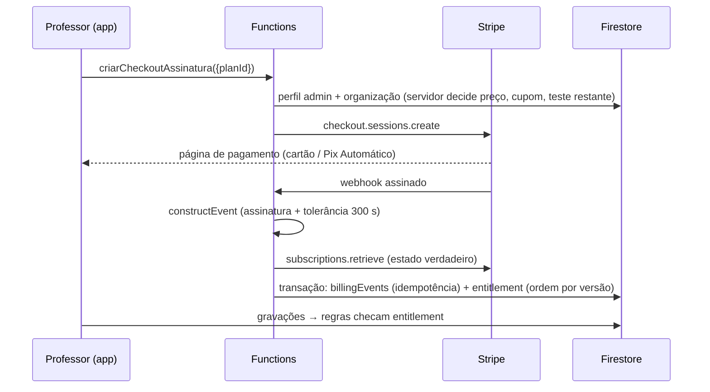

# Arquitetura — atual (V4) × implementada (V5)

## Decisão central

Manter a tecnologia-base (Firebase Hosting + Auth + Firestore, JavaScript sem build) e
**isolar tenants sem reestruturar os dados**. O V4 já gravava `organizationId` em todos os
documentos e já filtrava as consultas por ele; faltava o servidor impor isso. Migrar para
subcoleções `organizations/{org}/...` ou outro framework traria risco e custo sem ganho de
segurança equivalente.

## Comparação

| Aspecto | V4 em produção | V5 neste branch |
|---|---|---|
| Tenant | `organizationId` no documento; fallback silencioso para `org_jair` | Tenant vem do perfil; sem perfil válido nenhuma consulta é autorizada |
| Autorização | Regras de produção desconhecidas (anônimo bloqueado) | `firestore.rules` + `storage.rules` versionadas, 48 testes de isolamento/permissão (42 Firestore + 6 Storage) |
| Papéis | admin, aluno, responsavel | admin, professor, colaborador (leitura), aluno, responsavel; `platformAdmins` separado |
| Portal da família | Ativação sem verificar e-mail | Exige e-mail verificado; leitura restrita ao `alunoId` vinculado |
| Direito de uso | Inexistente | `organizations/{org}.entitlement` gravado só pelo backend; regras bloqueiam escrita sem teste/assinatura |
| Cobrança da plataforma | Inexistente | Functions: checkout, portal, webhooks (Stripe/Mercado Pago), reconciliação |
| Créditos | Duas gravações soltas | Transação única com estorno |
| Migração | — | Ferramenta com backup verificável, dry-run, verificação e rollback |
| Testes | Nenhum | 7 unitários, 84 no emulador, 8 E2E no Chromium; CI |
| Hosting | Rewrite catch-all (mascarava arquivo ausente) | Sem catch-all; ausência gera 404 |

## Modelo de dados

```
usuarios/{uid}            email, nome, role, organizationId, alunoId?, ativo
organizations/{orgId}     nome, ownerUid, createdAt (servidor), settings, timezone
                          billingExempt*   entitlement* {status, plan, accessUntil,
                          provider, subscriptionId, customerId, sourceVersion}
alunos | aulas | pacotes | despesas | leads | solicitacoes | materiais | convites
                          organizationId (chave do tenant), alunoId (quando aplicável)
auditLogs/{id}            organizationId, actorUid, at (servidor), action — só inserção
billingEvents/{id}*       registro de idempotência (sem dados pessoais)
platformConfig/public*    selfSignupOpen, billingEnabled, pixAulaEnabled (feature flags lidas pelo app)
platformAdmins/{uid}*     administração comercial da plataforma
platformMigrations/{id}*  registro das migrações aplicadas
* gravado somente pelo backend (Admin SDK); o cliente nunca escreve
```

## Matriz de acesso (imposta nas regras)

| Recurso | admin/professor do tenant | colaborador | família (aluno/responsável) | admin da plataforma | outro tenant |
|---|---|---|---|---|---|
| alunos, aulas, pacotes, materiais | CRUD | leitura | leitura do próprio aluno | — | — |
| despesas, leads | CRUD | leitura | — | — | — |
| solicitações | CRUD | leitura | cria (pendente) e lê as do próprio aluno | — | — |
| convites | CRUD (só alunos do tenant) | leitura | lê o próprio (e-mail verificado) | — | — |
| organização | lê; admin edita nome/configurações | lê | — | lê (metadados de cobrança) | — |
| cobrança (`entitlement`, `billingExempt`) | — | — | — | leitura | — |
| auditoria | admin lê; equipe insere | insere | — | — | — |

Escrita em dados do tenant exige `orgWritable`: organização isenta **ou** dentro de 14 dias
de `createdAt` **ou** `entitlement.status ∈ {active, past_due}` com `accessUntil` futuro.
Leitura e exclusão continuam permitidas após o vencimento (exportação e eliminação pelo titular).

## Fluxo de cobrança



## Separação plataforma × conteúdo dos clientes

O administrador comercial (`platformAdmins`) lê organizações e eventos de cobrança, mas
**não** lê alunos, aulas, financeiro ou arquivos dos tenants (testado). A conta do proprietário
acessa os próprios dados como membro da `org_jair`, não por privilégio de plataforma. Acesso
excepcional a dados de um cliente (suporte) deve ser feito por concessão explícita, temporária
e registrada — **pendente** de implementação.

O Jair OS/IROS não foi conectado ao ProfGestor nesta entrega. Qualquer integração deve usar
uma credencial restrita à `org_jair` (nunca Admin SDK com acesso a todos os tenants).

## Limitações conhecidas

- Um e-mail de família pertence a um único tenant (ID do convite = e-mail). Multi-organização exige `memberships`.
- Regras não filtram campos: notas privadas do professor devem sair dos documentos que a família lê.
- Limites por plano (ex.: nº de alunos) não são impostos pelas regras; exigem contador mantido pelo backend.
- Cada avaliação de regra usa até 2–3 `get()` (perfil, organização), cobrados como leitura; custom claims reduziriam isso.
